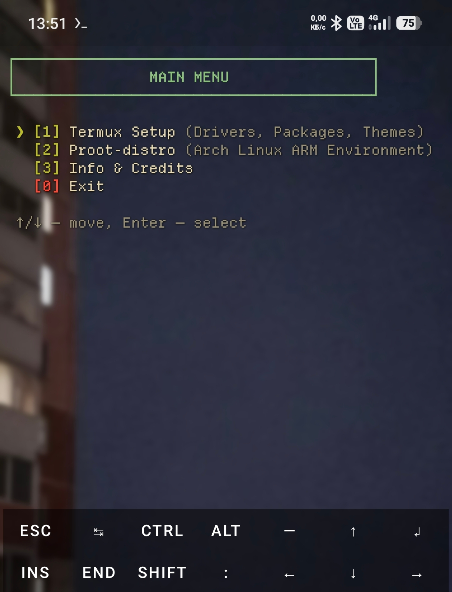
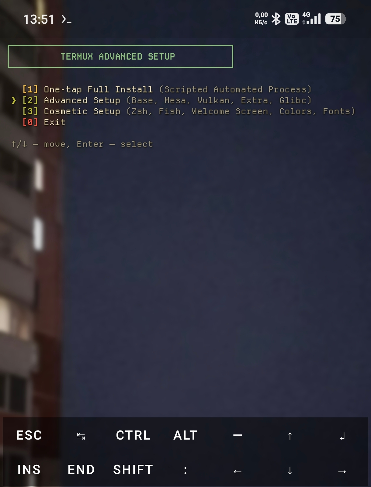
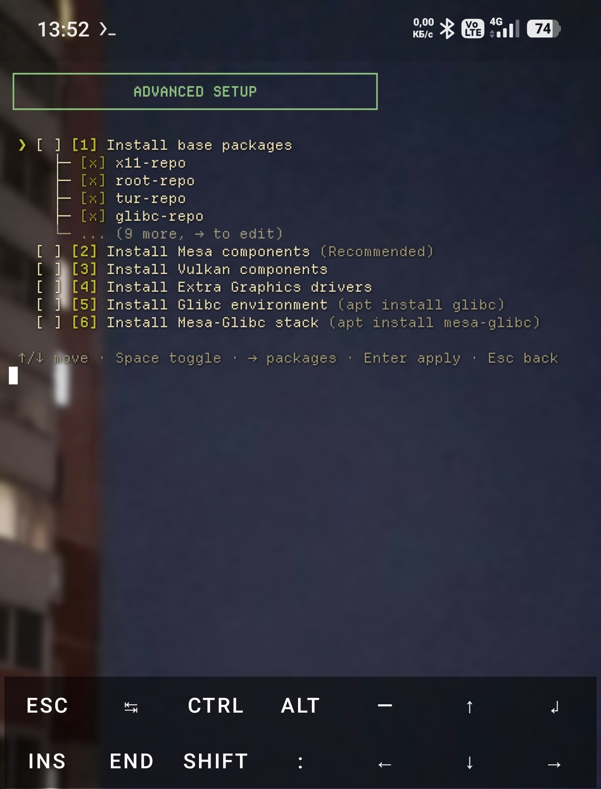
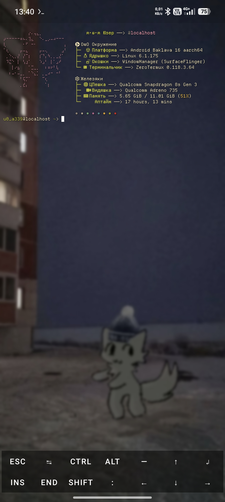

# Termux Setup

Automated setup toolkit for **Termux** and **PRoot Arch Linux ARM**.  
Interactive menus with arrow-key navigation, package trees, and one-tap installation.

## Screenshots

### Main Menu



### Termux Setup



### Advanced Setup — Package Tree



### After Auto Install



## Features

- Arrow-key navigation in every menu (`↑`/`↓`, `Enter`, `Esc`).
- Multi-select setup steps with `Space`.
- Tree-based package selection with a compact 5-line preview.
- Automatic exit after the one-tap installation finishes.

### Termux Setup

- **One-tap Full Install** — installs the full stack automatically.
  - Default shell selection: `bash`, `fish`, `zsh`.
  - Welcome screen selection: `fastfetch` or `rxfetch`.
- **Advanced Setup** — base packages, Mesa, Vulkan, extra graphics drivers, Glibc and Mesa-Glibc.
  - All packages are selected by default.
  - Press `→` on a category to choose exact packages from its tree.
- **Cosmetic Setup**
  - Zsh + Oh-My-Zsh + Powerlevel10k.
  - Fish shell (greeting disabled automatically).
  - Welcome screen via `fastfetch` or `rxfetch`.
  - Custom colors, font, fastfetch config and `.zshrc`.

### PRoot Distributions

- Choose a distribution: **Debian**, **Void**, **Arch Linux** or **Arch Linux ARM**.
- Each distribution has its own package tree:
  - base system packages;
  - kernel and firmware;
  - GPU / Mesa stack;
  - developer tools;
  - utilities (or YAY for Arch-based distributions).
- Arch-based distributions also create a custom user automatically.
- Arch Linux ARM additionally deploys the Mesa Turnip GPU stack.

## Requirements

- Termux (tested on `v0.119.0-beta3`)
- Internet connection
- `proot-distro` for the PRoot menu (installed automatically)

## Usage

```bash
git clone https://github.com/OceanSt0ne/Termux-setup.git
cd Termux-setup
chmod +x Setup/Start.sh
bash Setup/Start.sh
```

> `Start.sh` runs `apt update && apt upgrade -y` on launch.

## Controls

| Key | Action |
| --- | --- |
| `↑` / `↓` | Move between items |
| `Enter` | Select / apply |
| `Space` | Toggle category or package |
| `→` | Expand package tree |
| `←` / `Esc` | Go back |

## Project Structure

```text
Termux-setup/
├── Setup/
│   ├── Start.sh
│   └── Other/
│       ├── menu.sh
│       ├── Termux.sh
│       ├── Proot.sh
│       ├── .zshrc
│       ├── colors.properties
│       ├── font.ttf
│       └── fastfetch/
└── Preview/
    ├── MainMenu.jpg
    ├── TermuxSetup.jpg
    ├── AdvancedTermuxSetup.jpg
    └── AfterAuto.jpg
```

## Disclaimer

This project may contain bugs or layout issues. Use it at your own risk.  
The author is not responsible for broken environments or data loss.

## Credits

- **Developer:** OStone
